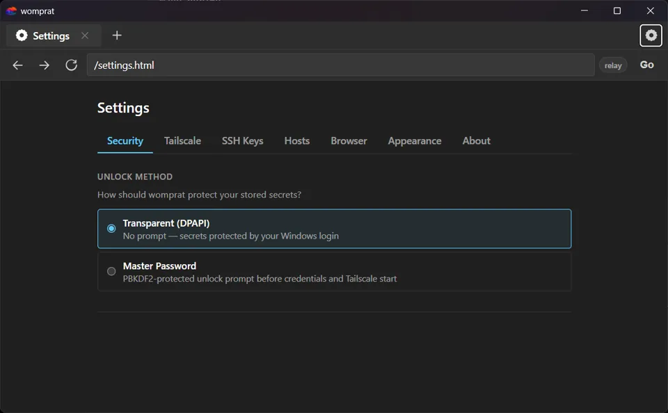

# womprat


Womprat opens SSH terminals, web applications, VNC desktops and RDP desktops on a Tailscale network in one tabbed window. It runs its own `tsnet` node, so you do not need to install the system Tailscale client or change the machine's network routes. Closing Womprat closes that node.

Windows ARM64 is the primary target. Downloads also include Windows x64 and a Linux x86-64 AppImage.



## Download and run

Get the application and its checksum file from [GitHub Releases][releases].

| Platform | Download | Requirements |
| --- | --- | --- |
| Windows ARM64 | `womprat-windows-arm64.exe` | Microsoft Edge WebView2 runtime |
| Windows x64 | `womprat-windows-amd64.exe` | Microsoft Edge WebView2 runtime |
| Linux x86-64 | `Womprat-<version>-x86_64.AppImage` | X11 or XWayland, `bubblewrap`, `xdg-dbus-proxy`, user namespaces |

Windows checksums are in `SHA256SUMS.txt`; Linux checksums are in `LINUX-SHA256SUMS.txt`. The [v0.4.5 rerelease notes][release-notes] explain why its tag and download hashes changed.

### Windows

Run the executable for your architecture. Current Windows 10 and Windows 11 installations normally include WebView2; install the [WebView2 Evergreen Runtime][webview2] if it is missing. No installer or administrator access is required for Womprat itself.

The executable can be copied between machines. Its encrypted settings and credentials are tied to the Windows user account and must be configured on each machine.

### Linux

On Fedora, install the sandbox helpers, then verify and run the AppImage as your normal desktop user. For v0.4.5:

```bash
sudo dnf install bubblewrap xdg-dbus-proxy
sha256sum --check LINUX-SHA256SUMS.txt
chmod +x Womprat-0.4.5-x86_64.AppImage
./Womprat-0.4.5-x86_64.AppImage
```

If FUSE is unavailable:

```bash
APPIMAGE_EXTRACT_AND_RUN=1 ./Womprat-0.4.5-x86_64.AppImage
```

GTK, WebKit and their helpers are bundled; graphics drivers and their C++ runtime come from the host. The WebKit sandbox stays enabled, including on Fedora Atomic layouts where `/opt` is a symlink. A host that forbids user namespaces cannot run this build.

Fedora 44 CI covers sandboxed startup, browser fixtures and restart/unlock behaviour. Live authenticated Linux tailnet browsing and exit-node recovery have not been independently verified here. Native Wayland, Linux ARM64 and Linux browser password saving are not implemented.

## Connect to your tailnet

Create a [Tailscale auth key][auth-keys] that can register Womprat's embedded node. Paste it into the startup auth-key field and select **Connect**, then open a service from the address bar:

```text
https://service.example/
ssh://user@host:22
vnc://host:5900
rdp://user@host:3389
```

Your tailnet access rules and service credentials still apply. SSH can use saved keys or prompt for a password; VNC and RDP credentials are entered in their tabs.

Public sites and search engines need an active exit node. Select one in Settings. Womprat preserves an exit-node route restored from its own tsnet state when no replacement is selected; Settings distinguishes the configured preference from an active route.

For custom or split DNS with an exit node, enable **Use with exit node** for the nameserver in the Tailscale admin console. `.local` names need a unicast DNS service such as [mdnsbridge][mdnsbridge]; Womprat does not send mDNS broadcasts. See [DNS configuration and troubleshooting][dns].

## Tabs, search and downloads

HTTP and HTTPS pages use independent native views: WebView2 on Windows and WebKitGTK on Linux. The shell keeps the tab strip and address bar in place while pages navigate. Tabs support back/forward, reload, content zoom and drag-to-reorder. Enable **Restore tabs** in Settings to reopen a saved session after startup or master-password unlock. Blank tabs and Settings are not saved.

Words and phrases search DuckDuckGo by default; Bing and Google are also available in **Settings > Browser > Address-bar search**. URLs, IP addresses, host-and-port addresses and SSH/VNC/RDP URLs open directly. For a single-label tailnet host, use `http://relay` or `relay/` to distinguish it from a search.

History completion stores up to 100 submitted addresses and searches in encrypted settings. Use Up/Down and Enter, click a suggestion, or press Escape to dismiss the list. Home's Recent cards come from saved session tabs, not a complete browsing history. Removing a card from Recent does not close its tab or change session restore.

Managed downloads use the tailnet connection and save to your `Downloads` directory without overwriting existing files. They run one at a time and remove incomplete files. A download started from a native browser tab can use its same-origin cookies, including HttpOnly cookies; cross-origin and direct API downloads start without browser cookies. Popup POST bodies and opener-window relationships are not preserved when a popup becomes a new tab.

| Shortcut | Action |
| --- | --- |
| `Ctrl+L`, `Alt+D` | Focus the address bar |
| `Ctrl+T` | New blank tab |
| `Ctrl+W` | Close the active browser or remote-display tab |
| `Ctrl+Tab`, `Ctrl+PageDown` | Next tab |
| `Ctrl+Shift+Tab`, `Ctrl+PageUp` | Previous tab |
| `Ctrl+1` ... `Ctrl+9` | Select a tab |
| `Ctrl+R`, `F5` | Reload the browser tab |
| `Alt+Left`, `Alt+Right` | Browser history |
| `Ctrl++`, `Ctrl+-`, `Ctrl+0` | Content zoom |

Terminal tabs reserve ordinary control chords for the remote shell. Use `Ctrl+Shift+T` to create a tab, `Ctrl+Shift+W` to close it and `Ctrl+Shift+L` for the address bar. Next/previous tab use `Ctrl+Shift+PageDown` / `Ctrl+Shift+PageUp`; `Ctrl+Shift+Tab` also moves to the next tab when a terminal is active. `Ctrl+C` copies a selection, or sends an interrupt when nothing is selected. [Terminal, remote-desktop and download details][usage] cover fonts, authentication, protocol limits and cookie handling.

## Network and security boundaries

Service traffic fails closed: if the embedded Tailscale route is unavailable, Womprat does not use host DNS or fall back to a normal LAN/internet connection. Release builds ignore `WOMPRAT_DIRECT=1`.

| Traffic | Route |
| --- | --- |
| Windows browser | WebView2 -> loopback SOCKS5 -> tsnet |
| Linux browser | WebKitGTK -> loopback HTTP/CONNECT proxy -> tsnet |
| SSH and managed downloads | Go client -> tsnet |
| VNC and RDP | Local WebSocket bridge -> tsnet |

The shell, APIs and proxies listen on loopback. APIs require a per-process session token; the HTTP server rejects foreign `Host` headers. The SOCKS and Linux content proxies do not authenticate individual local programs. Other software on the machine can explicitly use those proxies while Womprat is connected -- application-scoped routing is not isolation from local processes.

SSH host keys use trust on first use: Womprat pins the first key and rejects later mismatches. **RDP server certificates are not verified.** TLS encrypts an RDP connection when negotiated but does not authenticate its server; use trusted targets and verify them independently. VNC supports unauthenticated RFB and classic VNC password authentication, not every RFB security extension. RDP H.264 graphics are not implemented.

For eligible untrusted, expired or hostname-mismatched HTTPS certificates, **Proceed anyway** approves that host/certificate for the shared browser session, including other tabs. Restart Womprat to clear approval; a changed certificate needs fresh consent. Generic navigation errors, revoked certificates and client-certificate errors cannot use this exception.

### Local state

| Platform | Directory | Configuration and credential protection |
| --- | --- | --- |
| Windows | `%APPDATA%\womprat` | User-scoped DPAPI |
| Linux | `${XDG_CONFIG_HOME:-$HOME/.config}/womprat` | AES-GCM with a private machine-local `.keyfile` |

`config.enc` holds settings, saved tabs, history and host profiles; encrypted credential files are under `creds/`. Browser profiles use the browser engine's own storage, separate from Womprat's configuration encryption. Womprat does not encrypt the Linux WebKit profile.

The optional master password adds a PBKDF2-SHA256 check before protected API access, session hydration and Tailscale startup. It is an application gate; it does not replace DPAPI or derive the Linux encryption key. USB-contained state is not implemented.

## Troubleshooting

Open **Settings > Diagnostics** to check connectivity, the local proxy and public access through an active exit node. Public probes are marked `Skipped` without an exit node. Transient Tailscale startup failures retry every 15 seconds; explicit reconnect or disconnect cancels the previous retry worker.

Use **DNS lookup through Womprat** to see the selected nameserver, matching DNS rule, tailnet route, query transport and response. A successful lookup does not prove that the service port is reachable. Copied reports include private hostnames and IP addresses; review them before sharing. [DNS troubleshooting][dns] explains NXDOMAIN, empty responses, route errors and supported resolver transports.

## Build and test

The Makefile is the supported build entry point. Go 1.27.3 and Bun are required; Windows resources also need `llvm-windres` and Python 3.

```bash
make setup           # Check Windows tools, resolve dependencies, generate resources
make verify          # Frontend checks, Go tests/vet and Windows compile checks
make windows-arm64
make windows-amd64
make sha256
```

On Linux, `make linux-gui` builds the native host with a C toolchain, pkg-config, GTK3 and WebKitGTK 4.1 development packages. `make linux-appimage` uses Docker to package it and run Fedora 44 acceptance; the acceptance host must allow the normal-user WebKit sandbox. `make release` and `make release-intel` run the profiled Windows release checks and build ARM64 or x64 respectively.

Outputs go to `<project-temp-root>/build/dist`. `make paths` prints the locations; [AGENTS.md][agents] defines portable overrides, profiling and cleanup. `make help` lists targets. A plain `make linux` builds the shell/API server, not the desktop AppImage.

Further development and test references:

* [UX tests][ux-tests]: `make test-race`, `make ux-test`, scripted browsers and real remote services. Debug direct-dial tests do not validate live tailnet routing.
* [Linux packaging and release checks][linux-ci]: Fedora/Atomic layouts, sandbox, restart tests and profiling boundaries. Windows COM tests run on a Windows runner; Windows release jobs are independent of Linux acceptance.
* [Linux validation record][linux-report] and [release notes][release-notes]: measured results, known validation gaps and release-specific changes.

[releases]: https://github.com/rcarmo/womprat/releases/latest
[release-notes]: docs/releases/v0.4.5.md
[webview2]: https://developer.microsoft.com/microsoft-edge/webview2/
[auth-keys]: https://tailscale.com/kb/1085/auth-keys
[mdnsbridge]: https://github.com/rcarmo/mdnsbridge
[dns]: docs/dns-exit-node.md
[usage]: docs/usage.md
[agents]: AGENTS.md
[ux-tests]: tests/ux/README.md
[linux-ci]: docs/linux-appimage-ci.md
[linux-report]: docs/linux-acceptance-2026-11-01.md
